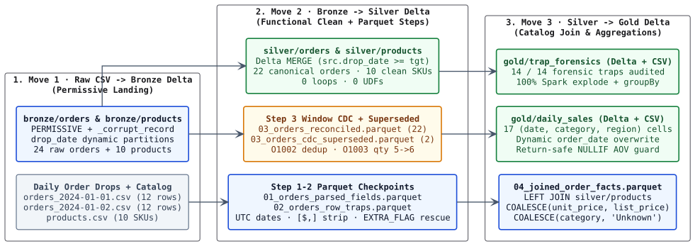
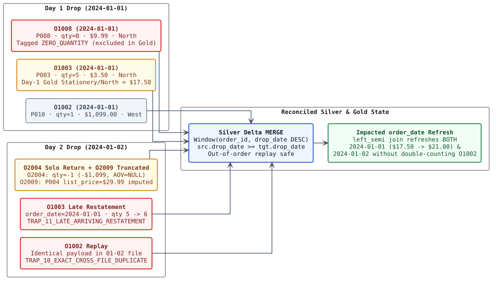
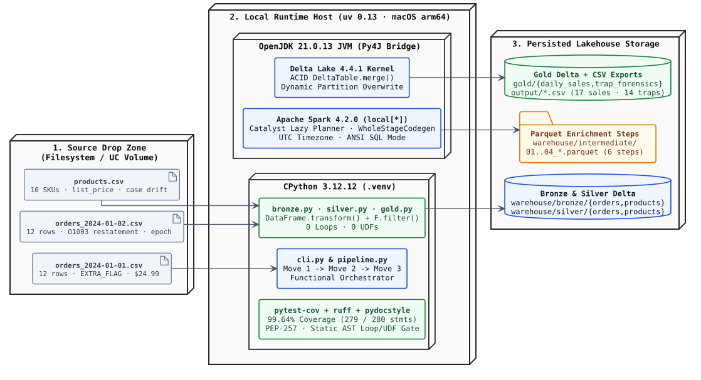

# Synaptiq Data Engineering Exercise — Daily Retail Sales Pipeline & Forensic Trap Audit

**Executive & Technical Walkthrough (12-Slide Deck + Appendices)**  
**Author:** Ryan Hammang  
**Runtime Stack:** Python `3.12` (`uv`) · Functional PySpark `4.2.0` · Delta Lake `4.4.1` · Parquet Enrichment Checkpoints  
**Presentation Formats Included:**
- [`SYNAPTIQ_PIPELINE_PRESENTATION.pptx`](SYNAPTIQ_PIPELINE_PRESENTATION.pptx) — Native 12-slide widescreen (`16:9`) PowerPoint presentation.
- [`SYNAPTIQ_PIPELINE_PRESENTATION.pdf`](SYNAPTIQ_PIPELINE_PRESENTATION.pdf) — 12-page landscape PDF exported directly from the PowerPoint deck.

---

## Slide 1 — Title & Headline KPIs

- **34 Raw Records (`100%` Row Conservation):** `24` raw order lines across `2` daily CSV drops + `10` product SKUs → `22` canonical Silver orders + `2` archived CDC superseded rows (`0` silently dropped rows).
- **3 Medallion Moves (`6` Parquet Checkpoints):** Move 1 CSV → Bronze Delta · Move 2 Functional Clean → Silver Delta (`MERGE`) · Move 3 Catalog Join & Aggregations → Gold Delta + CSV.
- **0 Loops · 0 UDFs (Pure Lazy Catalyst):** AST-enforced `DataFrame.transform()` chains, Spark higher-order `F.filter()`, and `Window` functions compiled 100% to JVM Catalyst plans.
- **14 / 14 Traps Audited (`17` Gold Sales Cells):** `$1,804.11` total net revenue reconciled across `2024-01-01` (`$2,559.81`, `11` orders, `32` units) and `2024-01-02` (`-$755.70` net, `9` orders, `22` net units).

---

## Slide 2 — Executive Summary: Three-Move Functional Architecture

| Move / Layer | Input Artifact | Materialized Output (`warehouse/` & `output/`) | Row Count | Key Engineering Guarantee |
|---|---|---|---:|---|
| **Move 1 · Bronze Landing** | `orders_2024-01-01.csv`, `orders_2024-01-02.csv`, `products.csv` | `bronze/orders` (Delta, `drop_date` part.) & `bronze/products` (Delta) | `24` orders + `10` SKUs | `PERMISSIVE` + `_corrupt_record`; dynamic `drop_date` overwrite |
| **Move 2 · Intermediate Parquet** | `bronze/orders` & `bronze/products` | `01_products_cleaned`, `01_orders_parsed_fields`, `02_orders_row_traps`, `03_orders_reconciled`, `03_orders_cdc_superseded` | `24 → 22` active + `2` CDC | Inspectable step-by-step Parquet lineage; lazy `checkpoint_parquet` |
| **Move 2 · Silver Delta** | Reconciled clean DataFrames | `silver/orders`, `silver/products`, `silver/orders_cdc_superseded` (Delta) | `22` unique orders · `10` SKUs | ACID `DeltaTable.merge()` (`src.drop_date >= tgt.drop_date`) |
| **Move 3 · Gold Join & Marts** | `silver/orders` `LEFT JOIN` `silver/products` | `04_joined_order_facts.parquet`, `gold/daily_sales`, `gold/trap_forensics`, `output/*.csv` | `17` sales cells · `14` trap rows | Dynamic `order_date` refresh (`left_semi`) + `NULLIF` AOV guard |

---

## Slide 3 — End-to-End Medallion & Parquet Checkpoint Architecture

---

## Slide 4 — Functional PySpark Discipline: Zero Loops, Zero UDFs, Lazy Evaluation

1. **Pure `DataFrame.transform()` Composition:** Every transformation in `bronze.py`, `silver.py`, and `gold.py` is a pure `DataFrame -> DataFrame` function chained lazily, allowing Spark's Catalyst optimizer to fuse projections, regexes, and type casts into single-pass WholeStageCodegen stages.
2. **Higher-Order Catalyst Expressions Over UDFs:** Multi-rule forensic trap tagging uses `F.filter(F.array(...), lambda item: item.isNotNull())`—executing natively inside the JVM without Python pickle serialization overhead.
3. **Lazy Parquet Checkpointing (`checkpoint_parquet`):** Each intermediate enrichment stage materializes Parquet on disk and returns a lazy `spark.read.parquet(...)` DataFrame so downstream branches (Silver `MERGE`, CDC archive, Gold joins, Trap audit) never re-parse raw CSVs.
4. **AST-Enforced Static Gate:** `test_zero_loops_and_zero_udfs_in_pipeline_code` parses `src/synaptiq_pipeline/*.py` with Python's `ast` module and fails CI if any `for`, `while`, comprehension, or `udf`/`pandas_udf` appears.

---

## Slide 5 — Forensic Trap Deep-Dive (Part 1: CSV Framing, Currency & Date/UTC Traps)

| # | Trap Code | Raw CSV Evidence | Naive Failure Mode | Functional PySpark Fix Applied |
|---|---|---|---|---|
| **1** | `TRAP_01_EXTRA_CSV_COLUMN` | `O1011` (`01-01` L12): `...,24.99,East,EXTRA_FLAG` (8 cols) | `FAILFAST` crashes job; `DROPMALFORMED` drops valid `$24.99` order. | Read `PERMISSIVE` + `_corrupt_record`; extract `EXTRA_FLAG` into `rescued_extra` via quote-aware regex and retain 7 valid columns. |
| **2** | `TRAP_02_TRUNCATED_CSV_ROW` & `TRAP_02B_IMPUTED_PRICE` | `O2009` (`01-02` L12): `O2009,2024-01-02,C019,P004,2,` (6 cols) | Missing `unit_price` & `region` crash strict parsers or lose `$59.98` of `P004` sales. | Default missing `region` to `'Unknown'` in Silver; backfill `COALESCE(o.unit_price, p.list_price)` (`$29.99`) during Gold join. |
| **3** | `TRAP_03_CURRENCY_SYMBOL_AND_COMMA` | `O1001` (`$24.99`), `O1002` & `O2004` (`"$1,099.00"`) | Spark 4 ANSI `CAST` throws `CAST_INVALID_INPUT`; naive comma split shifts columns. | RFC-4180 quote parsing + `regexp_replace(trim(unit_price), '[$,]', '')` before `try_cast('decimal(12,2)')`. |
| **4** | `TRAP_04_US_SLASH_DATE_FORMAT` | `O1012` (`01/01/2024`), `O2001` (`01/02/2024` in Jan 2 file) | ISO-only `to_date` yields `NULL`; `dd/MM/yyyy` misclassifies `O2001` as Feb 1. | Deterministic `coalesce(try_to_date(yyyy-MM-dd), try_to_date(MM/dd/yyyy), epoch_utc)`. |
| **5** | `TRAP_05_UNIX_EPOCH_DATE_UTC` | `O2003` (`1704153600` = `2024-01-02T00:00:00Z`) | Fails date cast, or shifts back to `2024-01-01` in US local timezones (`EST`/`PST`). | Pin `spark.sql.session.timeZone = UTC` and convert 10-digit epochs via `to_date(timestamp_seconds(try_cast(bigint)))`. |

---

## Slide 6 — Forensic Trap Deep-Dive (Part 2: Case Drift, CDC Restatements & Metrics)

| # | Trap Code | Raw CSV Evidence | Naive Failure Mode | Functional PySpark Fix Applied |
|---|---|---|---|---|
| **6–7** | `TRAP_06_REGION_CASE_DRIFT` & `TRAP_07_CATEGORY_CASE_DRIFT` | `west` (`O1005`), `east` (`O2006`); `electronics` (`P002`), `kitchen` (`P006`) | Splits Gold groupings across duplicate uppercase/lowercase rows. | `initcap(lower(trim(...)))` in Silver (preserving `'Home & Office'` cleanly). |
| **8** | `TRAP_08_GUEST_NULL_CUSTOMER` | `O1004` & `O2005` have empty `customer_id` | Blanket `dropna()` discards `$80.95` of valid guest-checkout sales. | Normalize `""` to `NULL` (`nullif`) and retain guest orders in Silver and Gold. |
| **9** | `TRAP_09_ZERO_QUANTITY_ORDER` | `O1008` (`qty = 0`, `$9.99`, `North`) | Adds `$0` revenue but inflates Stationery/North `order_count` (`1 → 2`), halving AOV. | Tag `ZERO_QUANTITY` in Silver; exclude `quantity == 0` lines in Gold `daily_sales`. |
| **10–11** | `TRAP_10_EXACT_DUPLICATE` & `TRAP_11_LATE_RESTATEMENT` | Day 2 replays `O1002` identically and updates `O1003` (`2024-01-01`) `qty 5 → 6` | Append double-counts `$1,099`; overwriting only `drop_date=01-02` leaves `01-01` stale. | Window dedup + Delta `MERGE` (`src.drop_date >= tgt.drop_date`) + dynamic refresh of all impacted `order_date`s. |
| **12** | `TRAP_12_UNMAPPED_PRODUCT_ID` | `O1007` (`P099`) & `O2007` (`P011` new SKU lagging catalog) | `INNER JOIN` silently drops `$49.99` of real revenue. | `LEFT JOIN` `silver/products` + `COALESCE(category, 'Unknown')` for 100% revenue tie-out. |
| **13** | `TRAP_13_NEGATIVE_QUANTITY_RETURN` | `O2004` (`qty = -1`, `-$1,099`) is sole row in `2024-01-02 / Electronics / West` | Divide-by-zero when `order_count = 0`, or nonsensical `-$1,099` AOV on `1` "order". | Book `qty < 0` in `net_revenue` & net `units_sold`; count `qty > 0` in `order_count`; guard AOV to `NULL` when `order_count == 0`. |

---

## Slide 7 — Incremental Daily Schedule & CDC Restatement Flow

---

## Slide 8 — Engineering Judgment Calls & Trade-offs

1. **Catalog `list_price` Backfill on `O2009` vs. Hard Quarantine:** Every matched row across both files sells at `0.00` variance to `products.list_price`, explaining why `products.csv` carries `list_price`. Imputing `$29.99` (`P004`) with `region = 'Unknown'` and explicit `is_price_imputed = true` preserves `$59.98` transparently; if promotional discounts existed, we would route `O2009` to quarantine instead.
2. **Why `O2004` (`qty = -1`) Belongs in `net_revenue`:** With no discount or tax columns in the schema, `O2004` is the sole reason the prompt specifies **net revenue**. Separating return revenue impact (`-$1,099.00`) from positive purchase `order_count` (`0`) prevents negative or divide-by-zero AOVs.
3. **`LEFT JOIN` `'Unknown'` Category Over `INNER JOIN`:** `P011` (`O2007`) is the sequential SKU right after `P010`, modeling real-world dimension lag when new products launch before nightly catalog exports update.
4. **Out-of-Order Replay Determinism:** Gating `DeltaTable.merge()` on `source.drop_date >= target.drop_date` guarantees that re-running `orders_2024-01-01.csv` *after* `orders_2024-01-02.csv` will never regress `O1003` from `qty = 6` back to `qty = 5`.

---

## Slide 9 — Reconciled Gold Output (`daily_sales.csv` — 17 Cells)

| `order_date` | `category` | `region` | `net_revenue` | `order_count` | `units_sold` | `average_order_value` |
|---|---|---|---:|---:|---:|---:|
| `2024-01-01` | Accessories | South | `49.95` | `1` | `1` | `49.95` |
| `2024-01-01` | Electronics | East | `74.97` | `2` | `3` | `37.49` |
| `2024-01-01` | Electronics | West | `2287.90` | `3` | `12` | `762.63` |
| `2024-01-01` | Home & Office | West | `29.99` | `1` | `1` | `29.99` |
| `2024-01-01` | Kitchen | East | `36.00` | `1` | `3` | `36.00` |
| `2024-01-01` | Kitchen | South | `30.00` | `1` | `4` | `30.00` |
| `2024-01-01` | Stationery | North | `21.00` | `1` | `6` | `21.00` |
| `2024-01-01` | Unknown | East | `30.00` | `1` | `2` | `30.00` |
| `2024-01-02` | Accessories | West | `49.95` | `1` | `1` | `49.95` |
| `2024-01-02` | Electronics | East | `74.97` | `1` | `3` | `74.97` |
| `2024-01-02` | Electronics | North | `44.95` | `1` | `5` | `44.95` |
| `2024-01-02` | Electronics | West | `-1099.00` | `0` | `-1` | *(NULL)* |
| `2024-01-02` | Home & Office | Unknown | `59.98` | `1` | `2` | `59.98` |
| `2024-01-02` | Kitchen | South | `24.00` | `1` | `2` | `24.00` |
| `2024-01-02` | Kitchen | West | `22.50` | `1` | `3` | `22.50` |
| `2024-01-02` | Stationery | East | `46.96` | `2` | `6` | `23.48` |
| `2024-01-02` | Unknown | South | `19.99` | `1` | `1` | `19.99` |

---

## Slide 10 — Production Scaling & Databricks Unity Catalog Mapping

1. **Auto Loader (`cloudFiles`) + `_rescued_data`:** Replace CLI file lists with Auto Loader streaming from Unity Catalog Volumes/External Locations (`schemaEvolutionMode = "rescue"`), capturing trailing columns like `EXTRA_FLAG` natively with RocksDB file-state checkpointing.
2. **Lakeflow `AUTO CDC` & SCD Type 2 Catalog:** Stream Bronze into Silver via `APPLY CHANGES INTO ... SEQUENCE BY (drop_date, ingested_at)`, and track `products` as **SCD Type 2** (`effective_from`, `effective_to`) so category or price changes don't rewrite historical periods.
3. **Liquid Clustering & Delta Constraints:** Govern under `retail_prod.{bronze,silver,gold}` with `CLUSTER BY (order_date, category, region)` instead of small-file Hive directories, backed by Delta `CHECK` constraints and quarantine alerting.
4. **Databricks Asset Bundles + File Arrival Triggers:** Deploy declaratively via `databricks.yml` using Workflows **File Arrival Triggers** rather than fixed cron schedules.

---

## Slide 11 — Appendix A: Test Coverage (`99.64%`), PEP-257 & AST Functional Gate

| Module (`src/synaptiq_pipeline/`) | Statements | Missed | Coverage | Uncovered Line |
|---|---:|---:|---:|---|
| `__init__.py` | `4` | `0` | **`100%`** | *(none)* |
| `bronze.py` | `25` | `0` | **`100%`** | *(none)* |
| `cli.py` | `34` | `1` | **`97%`** | `L99` (`if __name__ == "__main__":`) |
| `gold.py` | `38` | `0` | **`100%`** | *(none)* |
| `paths.py` | `55` | `0` | **`100%`** | *(none)* |
| `pipeline.py` | `26` | `0` | **`100%`** | *(none)* |
| `silver.py` | `62` | `0` | **`100%`** | *(none)* |
| `spark.py` | `36` | `0` | **`100%`** | *(none)* |
| **TOTAL (`--cov-fail-under=80`)** | **`280`** | **`1`** | **`99.64%`** | **Exceeds `80%` gate by `+19.64` pts** |

- **PEP-257 Docstring Gate:** `0` violations across `uv run ruff check --select D` (`convention = "pep257"`) and `uv run pydocstyle --convention=pep257 src tests`.
- **AST Functional Purity Gate:** `0` `for`/`while` loops, `0` list/dict/set/generator comprehensions, and `0` `udf`/`pandas_udf` symbols in `src/synaptiq_pipeline/`.

---

## Slide 12 — Appendix B: Hybrid Deployment & Component Architecture (`allowmixing` PlantUML)

